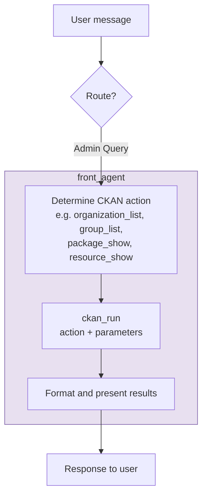

# Front Agent — Admin Query (Route D)

User asks about CKAN structure (orgs, groups, users, specific datasets by ID).

**Notes:** Single direct `ckan_run` call, no sub-agents involved. Delete/purge actions are blocked.
