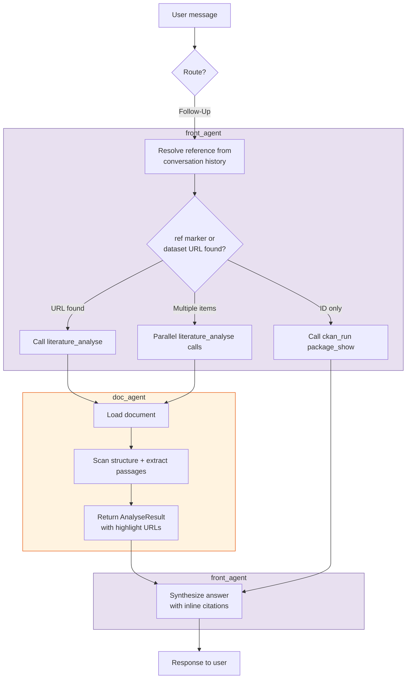

# Front Agent — Follow-Up Workflow (Route A)

User refers to a document, dataset, or resource already in the conversation.

**Forbidden tools:** `find_relevant_groups`, `literature_search`, `package_search`
