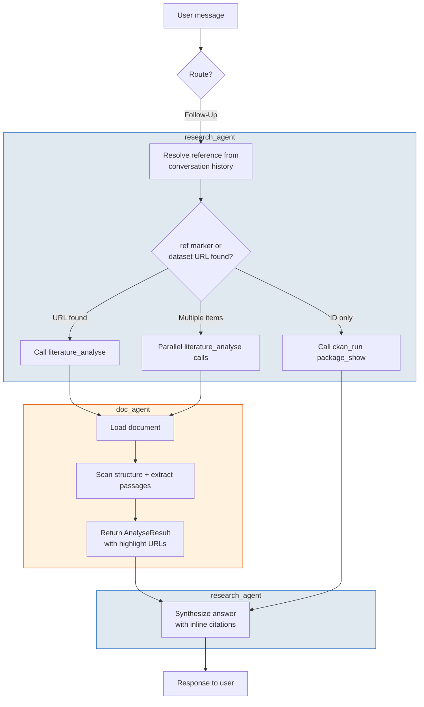

# Research Agent — Follow-Up Workflow (Route A)

User refers to a document, dataset, or resource already in the conversation.
Skips the 5-phase research process entirely.

**Forbidden tools:** `find_relevant_groups`, `literature_search`, `ckan_explore`
