# Research Agent — 5-Phase Research Workflow (Route B)

User asks a new research question not referencing prior results.

```mermaid
flowchart TD
    A[User message] --> B{Route?}
    B -->|New Research Question| P1

    subgraph research["research_agent — Phase 1: ANALYZE"]
        P1[Break question into key aspects]
        P1 --> P1b[Formulate hypotheses +<br>plan search strategy]
    end

    P1b --> GRP

    subgraph research2["research_agent — Phase 2: LITERATURE SEARCH"]
        GRP[Call find_relevant_groups]
    end

    GRP --> GS

    subgraph group["group_selector_agent"]
        GS[Select 1-2 relevant<br>CKAN group slugs]
    end

    GS --> LS

    subgraph research3["research_agent — Phase 2 contd."]
        LS[Call literature_search ×1-3<br>varied queries per aspect]
    end

    LS --> RAG

    subgraph rag["rag_search_direct  · ·  summary_agent ×N"]
        RAG[Vector search + parallel<br>per-source summaries]
    end

    RAG --> CE

    subgraph research4["research_agent — Phase 3: CKAN EXPLORATION"]
        CE[Call ckan_explore<br>task derived from question]
    end

    CE --> CKAN

    subgraph ckan["ckan_agent  (autonomous)"]
        CKAN[Multi-strategy search:<br>keywords → synonyms → groups → tags]
        CKAN --> CKAN2[Return datasets found +<br>queries tried]
    end

    CKAN2 --> P4

    subgraph research5["research_agent — Phase 4: DEEP ANALYSIS"]
        P4[Select top 3-5 sources<br>from Phases 2 + 3]
        P4 --> P4b[Call literature_analyse ×3-5]
    end

    P4b --> DOC

    subgraph doc["doc_agent  ×N"]
        DOC[Scan structure + batch-extract<br>relevant passages]
        DOC --> DOC2[Return AnalyseResult<br>with highlight URLs]
    end

    DOC2 --> P5

    subgraph research6["research_agent — Phase 5: SYNTHESIZE"]
        P5[Deduplicate + filter<br>for relevance]
        P5 --> P5b[Write report: direct answer +<br>cited sources + contradictions]
    end

    P5b --> Z[Response to user]

    style research fill:#e0e8f0,stroke:#1565c0
    style research2 fill:#e0e8f0,stroke:#1565c0
    style research3 fill:#e0e8f0,stroke:#1565c0
    style research4 fill:#e0e8f0,stroke:#1565c0
    style research5 fill:#e0e8f0,stroke:#1565c0
    style research6 fill:#e0e8f0,stroke:#1565c0
    style group fill:#e0f0e0,stroke:#2e7d32
    style rag fill:#fff3e0,stroke:#e65100
    style ckan fill:#fce4ec,stroke:#c62828
    style doc fill:#fff3e0,stroke:#e65100
```

## Tool budget

| Tool | Max |
|------|-----|
| `find_relevant_groups` | 1 |
| `literature_search` | 3 |
| `ckan_explore` | 1 |
| `literature_analyse` | 5 |
| **Total** | 8–15, ceiling 25 |

## Agent color legend

| Color | Agent |
|-------|-------|
| 🟦 Blau | research_agent (Orchestrator) |
| 🟩 Grün | group_selector_agent |
| 🟧 Orange | rag_search / summary_agent / doc_agent |
| 🟥 Rot | ckan_agent (autonomous) |
